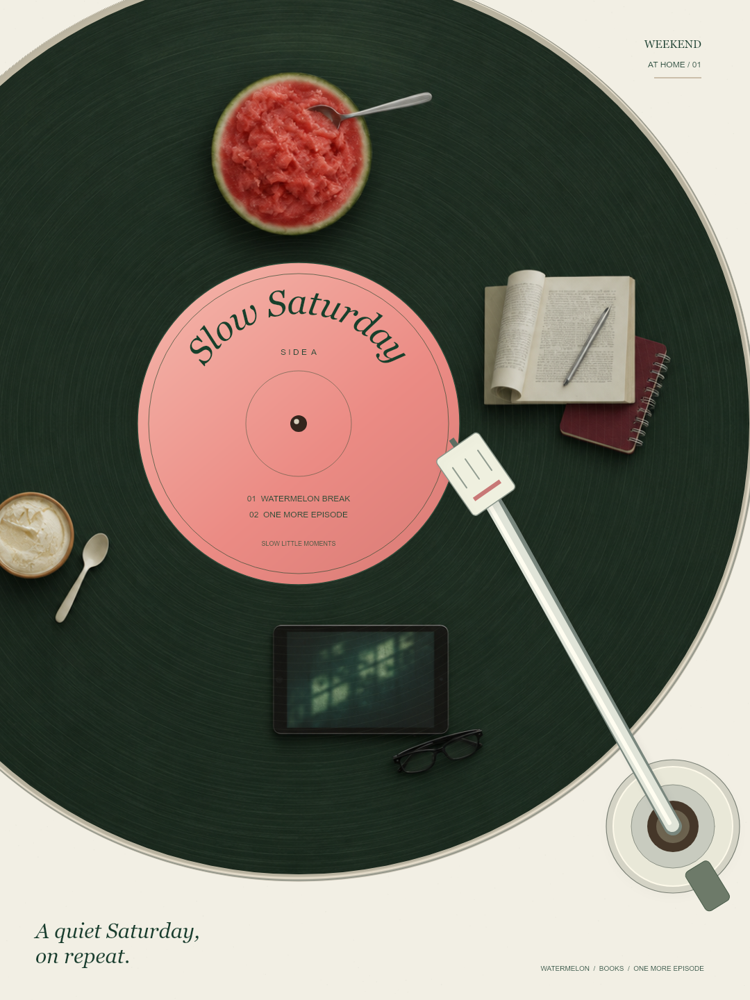

# Vinyl Scene Poster · 唱片里的微缩世界

Turn one photo into a model-generated overhead miniature world, then animate it as a looping vinyl poster.

输入一张照片，**先由图像模型重建统一的 90° 俯视场景，再让场景随唱片旋转**。盘标文字、固定唱臂和外部背景分别绘制。

[](demo.mp4)

[▶ 观看 6 秒 demo](demo.mp4) · [查看模型生成的俯视场景](demo-scene.png) · [读取 SKILL.md](SKILL.md)

## 本仓库包含什么

- `SKILL.md`：可复用的图片玩法技能，覆盖场景转译、俯视重建、配色、构图、动画和验收。
- `scripts/scene.js`：Canvas 2D 动画示例；盘面、盘标、唱臂分别绘制，共用确定性的 `renderFrame(t)`。
- `scripts/render.cjs`：逐帧生成封面与 MP4 的导出器。
- `demo-scene.png`、`cover.png`、`demo.mp4`：西瓜周末示例的模型场景、封面和成片。
- `references/example-prompt.txt`：该示例的完整图像生成提示词。
- `references/reference-analysis.md`：参考效果的动态、配色与版式拆解。
- `agents/openai.yaml`：Codex 技能界面信息。

## 使用 Skill

将本仓库作为一个完整技能目录加载到支持 `SKILL.md` 的创作代理中，上传一张照片并调用：

```text
使用 $vinyl-scene-poster，把这张照片变成唱片里的微缩世界。
先生成统一的垂直俯视场景，再输出循环视频、封面和动画源文件。
```

默认输出为 **1080 × 1440、3:4、30 fps、6 秒循环、无音轨**。主题与配色根据输入照片变化，不固定为泳池或西瓜。

## 重现 Demo

需要 Node.js 18+ 和支持 `libx264` 的 FFmpeg。

```bash
npm install
npm run render
```

结果写入 `outputs/`：`poster.mp4`、`cover.png`、`label.png`。如果 FFmpeg 不在 PATH，可设置 `FFMPEG` 为其可执行文件路径。

只生成封面：

```bash
npm run cover
```

使用自己生成的俯视场景：

```bash
npm run render -- --scene /absolute/path/to/overhead-scene.png --out /absolute/path/to/result
```

同时修改 `scripts/scene.js` 中的配色、标题、盘标短句和构图参数，使它们与新照片对应。导出器负责动画与编码，不会自动调用图像模型；先按 `SKILL.md` 完成俯视场景生成与检查。

下载仓库后可以直接打开 `demo.html`，循环播放随包视频；不需要安装依赖。

## 制作逻辑

1. 分析输入照片，保留主体形状、色彩和标志性物件。
2. 用图像模型重建从正上方看的完整场景；中心留出盘标区，主要物件进入外侧环带。
3. 验收俯视关系：杯口应接近正圆，平面物件平躺，不应保留原片的斜视产品角度。
4. 用圆形遮罩承载模型场景；盘面与盘标逆时针旋转，唱臂与外部背景固定。
5. 在统一周期中组织局部高光，逐帧导出，不把浏览器掉帧录入视频。

完整场景可以作为一个盘内图层旋转。只有确实需要独立动作时，才额外生成相同俯视角度的分层素材。

## 示例与验证

当前示例 **Slow Saturday / 西瓜周末** 从西瓜、冰淇淋、书本、平板和眼镜中提取周末主题，使用深西瓜绿、珊瑚红与奶油白。示例场景由内置 imagegen 生成，动效由 Canvas 2D 完成。

已检查技能格式、导出参数、四个动画阶段、0 秒与 6 秒的状态一致性。咖啡甜点与西瓜周末照片已用于实际测试；其他类型尚未完整验证。

字体使用系统 Georgia 与 Arial；没有这些字体的平台会回退，重导出时文字外观可能不同。字体文件、原始用户照片和原参考视频均未打入仓库。

## 许可与来源

原创技能说明与代码采用 [MIT License](LICENSE)。演示媒体为 AI 生成并经程序合成的示例；原始参考照片、视频及第三方字体与依赖的权利不由本仓库授予。详情见 [ATTRIBUTION.md](ATTRIBUTION.md)。
